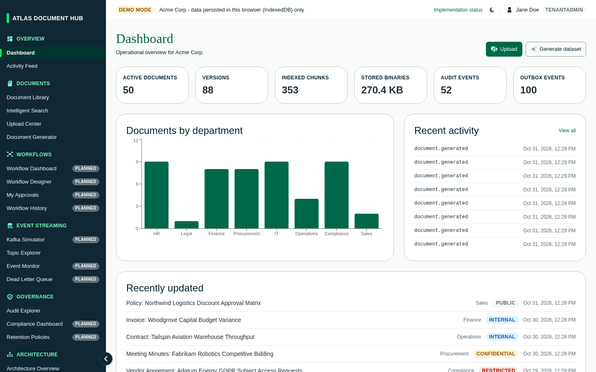
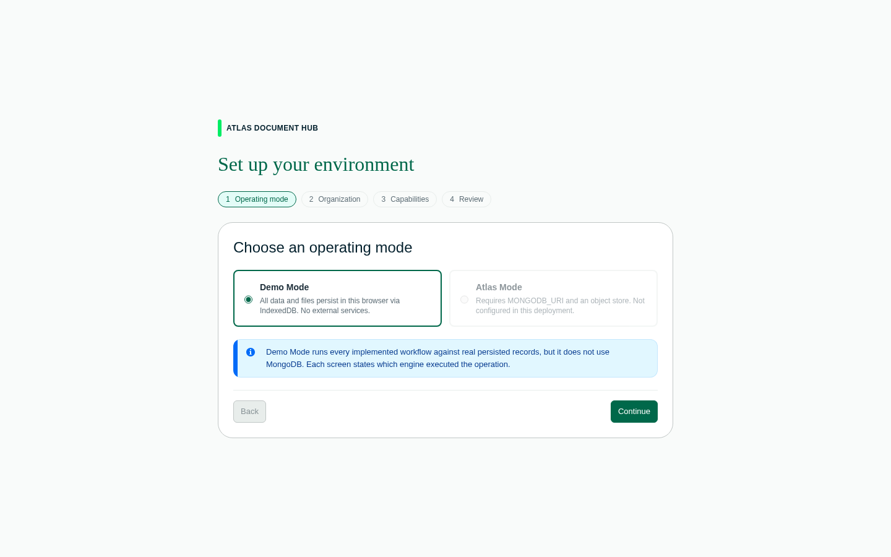
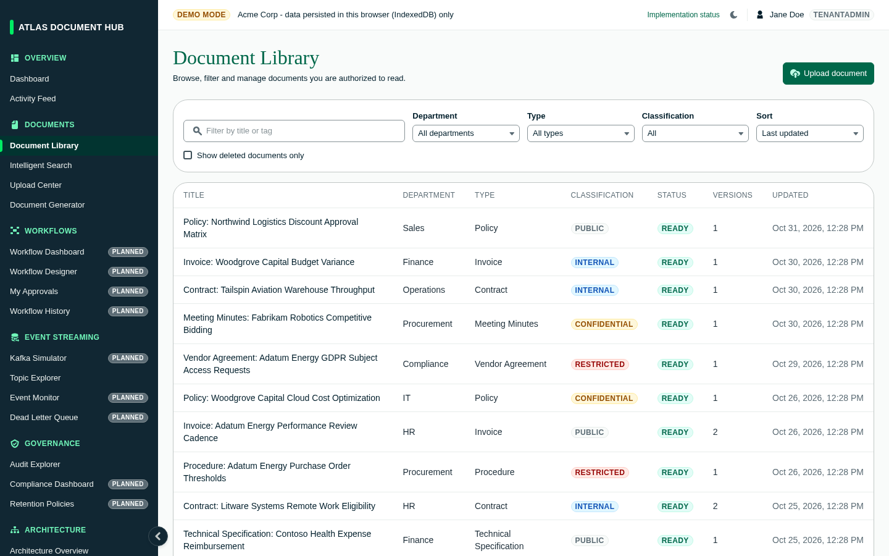
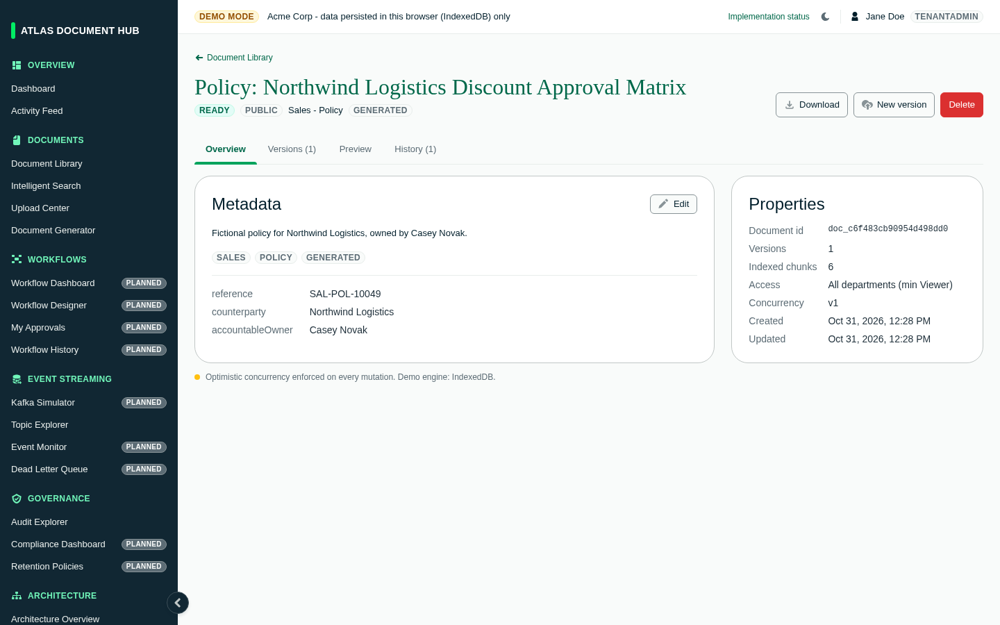
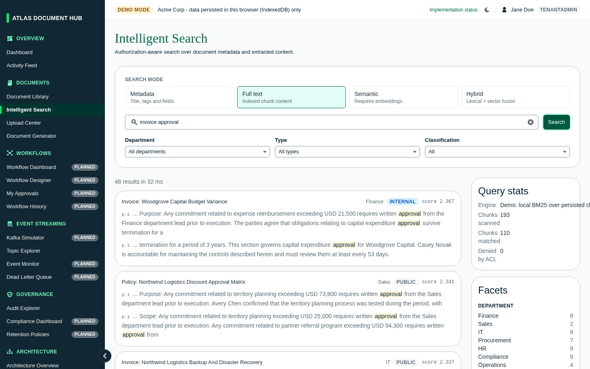
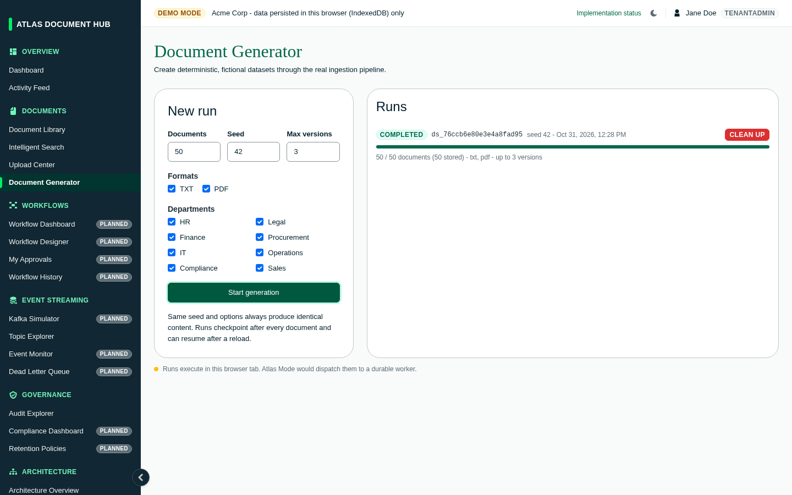
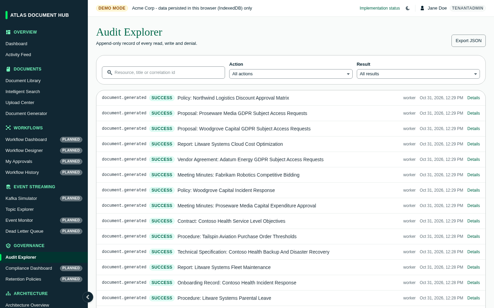
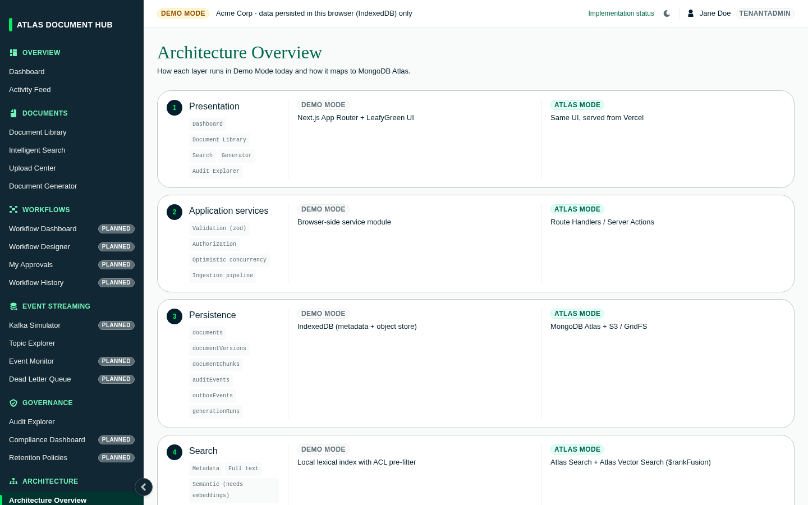

# MongoDB Document Management System

A document management console built with Next.js 16, React 19 and MongoDB's LeafyGreen design system. It shows how a MongoDB-backed document platform would handle storage, versioning, search, auditing and event streaming.

> **Current status: MongoDB Atlas only.** All documents, versions, chunks, audit events, outbox events, generation runs and settings are stored in MongoDB Atlas, and binaries are stored in GridFS. There is no local/browser database. `MONGODB_URI` must be set.



## Screenshots

Screenshots show 50 generated documents (seed 42). They were captured before the move to Atlas-only storage, so some labels still read "Demo Mode".

| | |
| --- | --- |
| **Setup Wizard**<br> | **Document Library**<br> |
| **Document Detail**<br> | **Intelligent Search**<br> |
| **Document Generator**<br> | **Audit Explorer**<br> |
| **Architecture Overview**<br> | |

## Getting started

Requirements: Node.js 20+, pnpm, and a MongoDB Atlas cluster (replica set, for transactions).

```bash
echo 'MONGODB_URI="mongodb+srv://..."' > .env.local
pnpm install
pnpm dev
```

Optionally set `MONGODB_DB` (defaults to `document_hub`). Open http://localhost:3000. The first visit goes to the **Setup Wizard** (`/setup`), which checks the Atlas connection. Finish it, then use the **Document Generator** (`/generator`) to create a sample dataset.

| Script       | Description              |
| ------------ | ------------------------ |
| `pnpm dev`   | Start the dev server     |
| `pnpm build` | Build for production     |
| `pnpm start` | Serve the production build |

## Features

| Area           | Route                          | What it does |
| -------------- | ------------------------------ | ------------ |
| Dashboard      | `/`                            | Counts, charts and recent activity |
| Activity Feed  | `/activity`                    | Timeline of system and user actions |
| Document Library | `/documents`                 | Browse, filter and sort documents |
| Document Detail | `/documents/[id]`             | Metadata, versions, preview and audit history for one document |
| Upload Center  | `/documents/upload`            | Upload files with metadata |
| Intelligent Search | `/search`                  | Local full-text search, with the equivalent MongoDB Search queries shown next to it |
| Document Generator | `/generator`               | Creates realistic sample documents, including PDFs |
| Topic Explorer | `/events`                      | Browse simulated event-stream topics and messages |
| Audit Explorer | `/audit`                       | Search and inspect the audit trail |
| Architecture Overview | `/architecture`         | Interactive diagram of the target Atlas architecture |
| System Settings | `/admin/settings`             | Demo configuration and data reset |
| System Health  | `/admin/health`                | Storage and component status |
| Setup Wizard   | `/setup`                       | First-run configuration |
| Implementation Status | `/status`               | Which modules are built and which are planned |

Sidebar items for modules that aren't built yet (workflows, Kafka simulator, compliance, retention, users and roles, and so on) open a placeholder page at `/planned/[slug]`. The full list is in `lib/navigation.ts`.

## Project structure

```
app/                 Routes (App Router)
components/
  shell/             App shell, sidebar navigation, page header
  setup/             Setup wizard
  dashboard/         Dashboard
  documents/         Library, upload form, detail view, metadata fields
  search/            Search workbench
  generator/         Sample data generator
  audit/             Audit explorer
  events/            Topic explorer
  architecture/      Architecture diagram
  admin/             Settings, health, implementation status
  shared/            Badges, toast notifications
lib/
  domain/types.ts    Domain model (documents, versions, audit entries, events)
  atlas/client.ts    MongoDB client, collections and GridFS bucket (server only)
  demo/store.ts      Client store backed by the Atlas API routes
  demo/services.ts   Document, version, audit and event logic
  demo/search.ts     Local search engine
  demo/generator.ts  Sample dataset generator
  demo/pdf.ts        Client-side PDF creation
  navigation.ts      Sidebar structure and planned pages
```

## Data and persistence

- Records live in MongoDB Atlas collections; each mutation's changed records are written in a single transaction via `app/api/atlas/state`.
- Uploaded and generated binaries are stored in the GridFS bucket via `app/api/atlas/objects` and re-verified by SHA-256 on read.
- `app/api/atlas/status` reports connection health (used by the Setup Wizard and System Health).
- **System Settings** can reset all data, which drops every collection and GridFS file.
- If Atlas is unreachable, the app shows an error with a Retry button instead of falling back to local storage.

## What's still client-side

- Domain logic (validation, ACL checks, chunking, ranking) still runs in the browser and is persisted through the Atlas routes. These routes have no authentication yet, so don't expose a deployment with real data.
- Search is BM25 over chunks loaded from Atlas, not Atlas Search. Atlas Search / Vector Search indexes are on the roadmap.

## Known issues

- `tsc` reports type errors because LeafyGreen's type definitions don't match React 19. They don't affect the running app, and `next.config.mjs` ignores type errors during builds.
- LeafyGreen's Toast uses `findDOMNode`, which React 19 removed. It's replaced by `components/shared/toast.tsx`, which has the same API.

## Tech stack

Next.js 16 (App Router, Turbopack) · React 19 · TypeScript · LeafyGreen UI · Tailwind CSS 4 · Recharts · React Flow (`@xyflow/react`) · SWR · Zod · MongoDB Node.js driver (GridFS)
